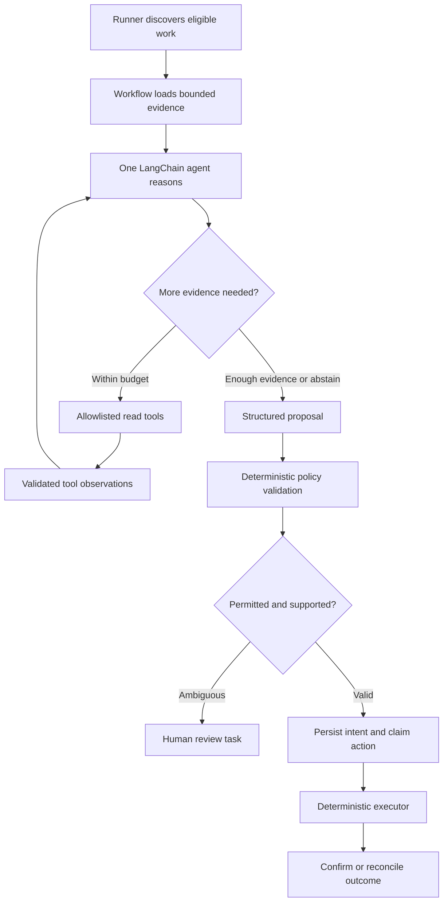

# EmailJira architecture and decisions

Version 0.1.0 · 2026-10-22 · Design baseline. [Requirements](requirements.md) v0.2.0 is normative for behavior, tables and numerical defaults. This is a single local Windows application with one agent, not a collection of services.

## Components and dependencies

| Component | Responsibilities | Constraint |
| --- | --- | --- |
| Local runner | Intake polling, human-decision checks, due digests, bounded pending-work/recovery, instance ownership, shutdown | Cooperative bounded work; one poison item cannot starve other activities. |
| Agent runtime | Interpret email, choose bounded investigation tools, retrieve evidence iteratively, produce structured proposal | LangChain + local Ollama; no direct external write or send capability. |
| Domain | Matching, lifecycle, review, payload identity and approval/execution guard decisions | Pure business logic independent of LangChain/HTTP/SQLite. |
| Workflows | Coordinate retrieval, validation, persistence, claims, effects and reconciliation | Deterministic validation before every permitted effect. |
| Adapters | Gmail OAuth/API, Jira API, Ollama, SQLite, Windows notifications/scheduling support | Timeouts, validated boundaries, explicit failures; no production fake fallback. |

Repository locations follow the supplied target tree: src/mail_jira_agent/{domain,workflows,agent,adapters}, migrations, tests, evaluations, scripts. Create each file only when its delivered feature needs it. No domain database/network access, and no framework in domain models. Python 3.12/uv/Ruff/mypy/pytest are fixed project constraints; library versions verified/locked during Phase 1/2.

## Agentic investigation and execution boundary

The loop is agentic: the agent selects evidence tools and updates its interpretation from observations before proposing. Reading tools expose bounded account-scoped queries, source messages and relevant verified context, not unrestricted clients. Human review-task creation is itself a deterministic, allowlisted, correlated write. The diagram does not grant all proposal types immediate execution: draft/send actions have additional version/approval gates.

## Data authority and logical storage

| Information | Authority | Stored locally |
| --- | --- | --- |
| Received message and current editable draft | Gmail | Account/message/thread/source identity and minimal permitted evidence, not a mailbox mirror |
| Verified mapping/event/business stage | SQLite | Structured facts, provenance, superseded corrections and derived state |
| Human notes/review/approval decisions | Jira | Verified actor/version/decision evidence for validation; app cannot forge authority by writing local state |
| Approved payload and execution history | SQLite | Immutable protected payload bytes/manifest identity, version, action correlation and outcomes |

Business progress, human review, approval and execution remain independent dimensions; requirements section 5 and ORD-01/APP-01/REVIEW-01/APR-01/EXEC-01 define transitions. Store UTC instants, preserve date-only values and unknown timezones. Monetary amounts use exact decimals with currency; do not combine currencies or partial scope blindly.

SQLite table designs/migrations are deferred until needed. Phase 1 requires migration/transaction/connection safety, not empty order/approval tables. Related local changes transact together; network calls outside long DB transactions. Enforce instance exclusion plus atomic per-action ownership when actual actions are introduced. Concurrency protection must cover all external actions, not just sends.

## Processing, writes and recovery

1. Discover under activation/scope policy and persist enough checkpoint/identity to avoid lost work.
2. Retrieve/decode bounded source evidence; agent investigates with limited read tools.
3. Validate schema, evidence, matching, allowed fields and business transitions. Consequential ambiguity produces review.
4. Persist accepted facts and stable intended-action identity before external submission; atomically claim action.
5. Execute through adapters. Record confirmed provider identity only with evidence. Definitive rejection is known failed; possible submission without confirmation is uncertain.
6. On restart or restored backup, reconcile remote effects before repeating uncertain operations. Empty search, elapsed time and process death do not establish no effect. Inconclusive or multiple matches remain blocked for review.

Feasibility of durable issue/comment correlation and verified human actors is demonstrated in Phase 2 against the selected Jira edition; unsupported capabilities block dependent behavior instead of weakening recovery/approval rules.

## Drafts and exact approval

Workflow creates a Gmail draft after recipient/content validation. Snapshot includes From/To/CC/BCC/subject/body and attachment identity; DEC-10 defines deterministic representation and SHA-256. Reviewer must see the exact current version and full payload through permitted views. Human approval is an explicit provider-evidenced decision; app-authored comments are never approval.

Executor rechecks current authorized decision, version, relevant facts, payload identity, enablement and execution history. Sending cannot consume different editable-draft content under old approval. Implementation chooses an API/payload handling path that satisfies this invariant and tests it; no separate race workstream or invented provider atomicity. Missing/changed/stale/uncertain approval blocks. Uncertain send reconciles before retry; unresolved cases need human review.

## Design decisions and deferred choices

| Decision | Rationale | Verification/gate |
| --- | --- | --- |
| Single local process + one agent | Agreed small-scope operational model | REQ-GOV-001–004; architecture review |
| LangChain first; LangGraph later | Preserve accepted behavior before orchestration migration | REQ-MIG-001–003, Phase 8 only |
| SQLite structured state | Durable recovery without external infrastructure/mailbox mirror | REQ-REC-001–012; temp real DB and restart tests |
| Agent proposes, deterministic executor writes | Bound authority despite hostile content/model errors | REQ-AGT-002/003/009; REQ-APR-009/010 |
| Jira existing issue capabilities, not custom portal | Human work within agreed tool | REQ-JIR-001–007; actual mappings pending Phase 2 |
| DPAPI + ACL; loopback local model | Protect at rest and avoid unnecessary exposure | REQ-AUTH-004; REQ-SEC-014; real Windows checks |
| Versioned restricted JSON manifest, no JCS dependency | Stable unambiguous approved content identity | DEC-10; REQ-APR-003; test vectors |

Numerical model/resource/schedule/retention defaults remain solely in requirements section 11; do not duplicate competing values here. Gmail account/date, Jira access/mappings, reviewer identities, provider obligations and live enablement are external gates with owner/deadline in the [Phase 0 review](phase-0-validation.md).

## Delivery boundary

Phase 1 creates a runnable foundation. Phase 2 verifies integrations/model. Phase 3 implements SLICE-01, not all lifecycle features. Phases 4–6 complete tracking, approval and operation; Phase 7 accepts/releases. No application runtime exists at Phase 0 closeout. Later runbook and release instructions must describe actual commands, not placeholders.
